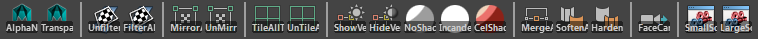

# MayaUtilities

---

This is a set of MEL scripts useful for anyone importing models into Maya often

All of the individual scripts on this repo are stored within the button shelf file 'shelf_Utilities.mel'

It must be placed in **%MAYA_FOLDER%/%VERSION%/prefs/shelves/** so that Maya can find and load the custom shelf

You may rename the shelf however you wish, the shelf name format  being `shelf_NewName.mel` (if you decide to do so, you also need to change the first line of your `shelf_NewName.mel` script accordingly)

Otherwise, the individual scripts can be copy-pasted into the Script Editor MEL and saved as shelf buttons onto any existing shelf, by doing **File** -> **Save script to shelf...** in the Script Editor.
Each script is self-contained, so any of them can be used on its own.

If you change a script in `scripts/`, run `python build_shelf.py` to rebuild `shelf_Utilities.mel` from the scripts.

**Options**
The first button, **Options**, opens a small window with the settings of the scripts. They are saved in your Maya preferences, so they are kept from one session to the next:

- **Affect**: *Whole scene* (the default) or *Selected objects*: whether the scripts change everything in the scene, or only the selected objects (and their materials and textures)
- **FilterAllTextures**: the filter type it sets (Mipmap, Box, Quadratic (default), Quartic, Gaussian)
- **MergeAllVertices**: the merge distance (0.001 by default)
- **Soften / Harden**: unlock the normals first (on by default: imported models often have locked normals, on which SoftenAllEdges / HardenAllEdges have no visible effect)
- **FaceCameraAlways**: one billboard per group of connected faces (default) or per face, and the camera they face (`persp` by default)

Every script can be undone in one go with **Ctrl+Z**, and prints what it changed in the Script Editor / command line.

For more details on importing models into Maya and what these scripts do, see [this page](https://github.com/scurest/apicula/wiki/IMPORT:-Maya)

**Animation Notice**
If you have trouble importing animations into Maya from COLLADA DAE models, you can use [this script by Inferry & scurest](https://gist.github.com/scurest/0db0cc8eec1ac744f88afbe1d320f3da) which will split a DAE file into several files, one for each animation.
You can run this script by saving doing `py splitter.py file.dae` in the directory where you put it.

Here is a short description of each MEL script (by default they change the whole scene; see **Options** to only change the selected objects):
---

- **AlphaNodeCorrect**: Plugs the transparency of each material's texture (from its alpha channel: `outTransparency`) into the material's transparency. Use this if the parts of the model which should be transparent appear opaque.

- **TransparencyCorrect**: Make alpha channels work properly for imported models by setting 'alpha is luminance' to false. Use this when the entire model is more or less see-through, it will make the correct parts of the model opaque as they should be.

---

- **UnfilterAllTextures**: Sets every image texture in the scene to be unfiltered (ie: aliased, pixelated)

- **FilterAllTextures**: Sets every image texture in the scene to have quadratic filtering (or another filter type, see **Options**)

---

- **MirrorAllTextureUVs**: Make it so all UV nodes in the scene have U & V mirrored texture space

- **UnMirrorAllTextureUVs**: Make all UV nodes in the scene have U & V mirroring set to false

---

- **TileAllTextureUVs**: Make it so all UV nodes in the scene have repeating tiled texture space

- **UnTileAllTextureUVs**: Make it so all UV nodes in the scene only have texture space within the 0-1 UV square, so the outside of this UV space is a solid color

---

- **ShowVertexColors**: Make all objects in the scene display their polygon vertex colors (multiplied with the material's ambient color)

- **HideVertexColors**: Make all objects in the scene hide their polygon colors

---

- **NoShade**: Make all materials full-lit 100% diffuse (shows the texture as is, with no lighting)

- **Incandesce**: Make all materials have their 'Incandescence' set to 1 - can be useful to get that full-lit look on the Maya legacy default viewport.

- **CelShade**: Make every material's ambient lighting use a simple 3-step ramp shader (a single shared `ModelUtilities_celShade` ramp: edit it to change every material at once)

- **RestoreShading**: Undoes NoShade, Incandesce and CelShade: puts back each material's original diffuse, incandescence, ambient and specular colors (saved by those scripts)

---

- **MergeAllVertices**: Merges together any vertices that are within 0.001 distance of each other (the distance can be changed in **Options**)

---

- **SoftenAllEdges**: Makes every edge of every polygon object have soft normal shading

- **HardenAllEdges**: Makes every edge of every polygon object have hard polygonal normal shading

---

- **FaceCameraAlways**: Makes it so the selected polygon faces are always facing the camera: they are moved into new `*_billboard` objects, with their pivot at their center, and an aim constraint to the default maya 'persp' camera (or another camera, see **Options**). By default, each group of connected selected faces becomes one billboard (so that a quad made of 2 triangles stays in one piece).

---

and these last 2 scripts are specifically intended for submitting model rips to [the Models Resource](https://www.models-resource.com/)

- **SmallScreenshot**: Saves a 148x125 png screenshot of the current view (without HUD elements and bone joints)

- **LargeScreenshot**: Saves a 750x650 png screenshot of the current view (without HUD elements and bone joints)
